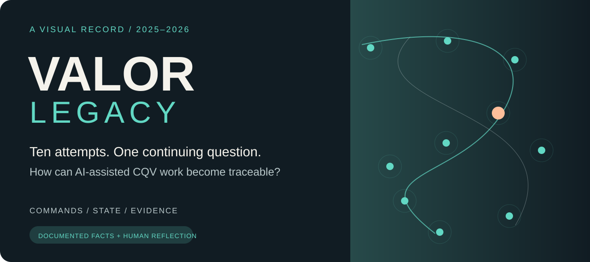
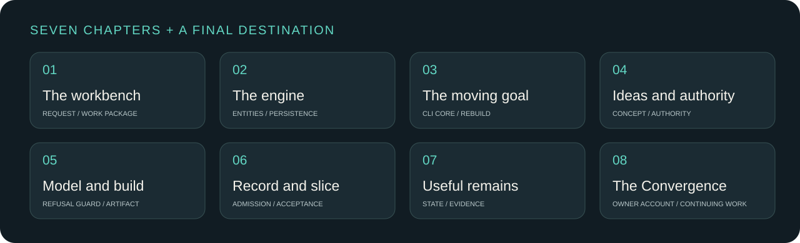
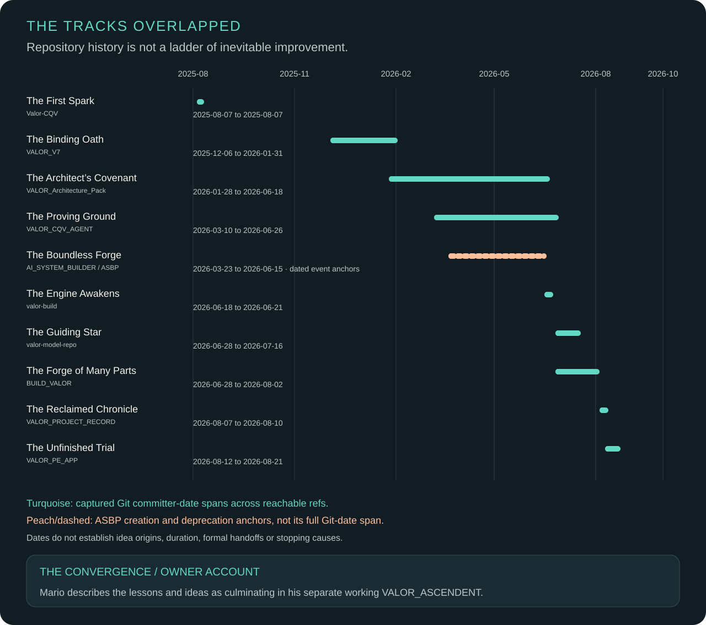

# A long journey, made readable

**A project-history presentation by Amr Hassan.** Published for display and reference; [rights and attribution](RIGHTS.md).

VALOR_LEGACY tells the story of ten attempts to make AI-assisted commissioning, qualification and validation (CQV) work more structured and traceable. It follows instruction packs, architecture, explicit state, model-driven builds and narrower experiments through useful ideas, changing intent and incomplete scope.

The evidence is allowed to disagree. A source can retain an old description beside a later decision; an accepted checkpoint can coexist with an unaccepted branch. The story keeps those distinctions visible.

**Three ways in:** [Read the story](story/README.md) · [Inspect one case](cases/README.md) · [Follow the dates](timeline/README.md)

| Chapter | The question it opens |
|---|---|
| [01 · Giving the assistant a workbench](story/01-workbench.md) | How does a request become a work package? |
| [02 · When the ambition became an engine](story/02-engine.md) | What changes when state becomes explicit? |
| [03 · The goal moved more than once](story/03-moving-goal.md) | What did the attempt aim to become? |
| [04 · Taking ideas without importing authority](story/04-ideas-and-authority.md) | How does an idea earn design authority? |
| [05 · Making the model govern the build](story/05-model-and-build.md) | What should a refusal leave untouched? |
| [06 · Recovering the record, narrowing the experiment](story/06-record-and-slice.md) | What exactly was admitted or accepted? |
| [07 · What remained useful](story/07-useful-remains.md) | Which lessons deserve to survive? |
| [The Convergence](story/08-the-convergence.md) | Where did Mario bring the lessons and ideas together? |

## Ten cases, many overlapping tracks

| Case | What to look for |
|---|---|
| [The First Spark](cases/01-valor-cqv.md) | Advisory origins |
| [The Binding Oath](cases/02-valor-v7.md) | Layered instructions |
| [The Architect’s Covenant](cases/03-architecture-pack.md) | Authority, contracts and schemas |
| [The Proving Ground](cases/04-cqv-agent.md) | A structured agent pack |
| [The Boundless Forge](cases/10-asbp.md) | An overlapping software attempt |
| [The Engine Awakens](cases/05-valor-build.md) | Runtime beside a stale label |
| [The Guiding Star](cases/06-model-repo.md) | Governed content and identity |
| [The Forge of Many Parts](cases/07-build-valor.md) | A modular factory and bounded acceptance |
| [The Reclaimed Chronicle](cases/08-project-record.md) | Recovery and decision boundaries |
| [The Unfinished Trial](cases/09-pe-app.md) | Accepted M0 and an unmerged later proposal |

[Read the dated notes and source limits →](timeline/README.md)

## Small mechanisms, useful lessons

The journey connects explicit state, refusal before allocation, traceable evidence and acceptance tied to a particular scope. These lessons are explained through the historical case accounts and original diagrams.

[State, evidence, authority, scope and honest acceptance →](lessons/README.md)

## How to read the evidence

**Documented fact** names what a retained source supports. **Owner recollection** carries Mario's personal account when supplied. **Interpretation** explains a lesson without inventing an outcome. Repository dates anchor artifacts; they do not define when an idea began or why every attempt ended.

[Sources and pinned identities](sources/README.md) · [Original visual assets](assets/README.md) · [Rights and attribution](RIGHTS.md)

## The Convergence

**Owner account.** Mario says the lessons and ideas from these attempts culminated in his separate working project, [VALOR_ASCENDENT](https://github.com/Cyber-Mario1979/VALOR_ASCENDENT).

[Follow The Unfinished Trial into The Convergence →](story/08-the-convergence.md)
