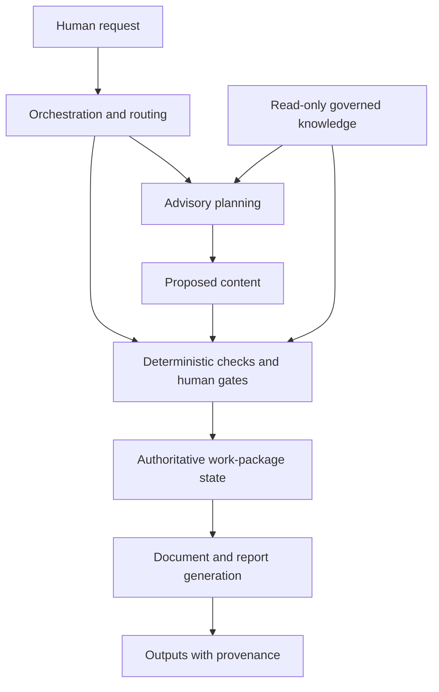

# Exhibit 1 · Intended authority boundaries

**Original curatorial diagram.** This is a new interpretation of historical architecture documents, not the source blueprint, an implemented-system diagram or proof of operational behavior.

The architecture sought to make advice and proposals distinct from committed work-package truth. Orchestration selected a route; deterministic contracts and explicit gates governed changes. Document and reporting layers consumed controlled state.

The instruction packs explored related ideas but structural checks on a pack do not implement this whole boundary. valor-build later contains runtime pieces, while its documentation disagrees about progress and freeze status. The synthetic PE application is a narrower branch of work, not evidence that this complete architecture was delivered.

Sources: [architecture intent](../sources/README.md#s03), [agent-pack limits](../sources/README.md#s04), [build adapter](../sources/README.md#s05).
