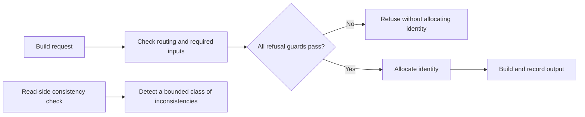

# Exhibit 2 · Refusal before irreversible identity allocation

**Original conceptual diagram.** It summarizes a recorded defect and its correction without copying implementation or governed schemas.

The model repository’s orphan-mint disposition describes an earlier ordering in which a builder allocated an append-only identity and then correctly refused the build. A correct refusal could therefore leave an unwanted identity record. The recorded remedy moved refusal guards ahead of allocation and added protective checks.

The source marks the issue CLOSED/DISCHARGED and reports the tracked ledger clean and rendered documents unaffected. This exhibit does not reopen the issue or claim corruption of accepted outputs. A reader can detect only the inconsistencies it knows how to recognize; a reader check complements the writer’s ordering rather than replacing it.

This is a historical lesson about making failed operations leave the intended state. It does not establish a new implementation or the reason the model track ended.

Source: [model defect disposition](../sources/README.md#s06).
