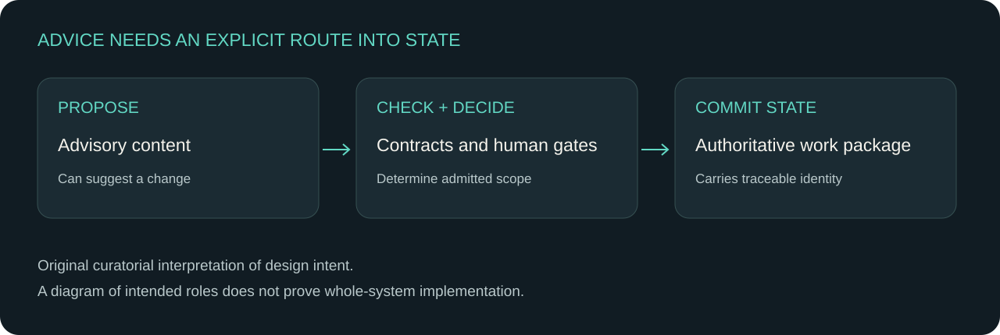

# Taking ideas without importing authority

A historical VALOR-ASBP note offers a bridge between the attempts: consider concepts for adoption, rewriting, rejection or deferral while keeping architecture authority separate and avoiding implementation transfer. The note is undated; its instruction is evidence of an intended review, not proof that the review occurred.

The architecture pack also separates advisory planning from authoritative work-package state. Later consumer wording calls the pinned architecture frozen while the architecture README remains pre-freeze. Both statements belong beside their sources.

**Interpretation:** a promising idea still needs an explicit route into a governed design. The diagram below explains historical intent and makes no implemented-system claim.

Read [The Architect’s Covenant](../cases/03-architecture-pack.md), [The Proving Ground](../cases/04-cqv-agent.md) and [The Engine Awakens](../cases/05-valor-build.md).

Sources: [S03](../sources/README.md#s03) · [S04](../sources/README.md#s04) · [S05](../sources/README.md#s05) · Historical bridge source LOCAL-1 is retained in private review.

[← The goal moved more than once](03-moving-goal.md) · [Making the model govern the build →](05-model-and-build.md)
