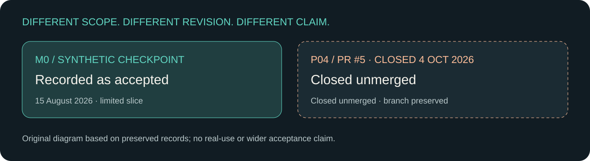

# Recovering the record, narrowing the experiment

PROJECT_RECORD treats evidence admission and decision authority as separate questions. Its retained current-state wording still calls a repair proposed beside the later PR #4 merge. The merge does not itself establish complete substantive model work.

PE_APP explores a narrower synthetic application slice. Its M0 checkpoint is recorded as accepted. The later PR #5 is closed unmerged with eight branch-only commits and three unresolved review threads; P04 owner browser acceptance was not performed.

**Documented fact:** accepted M0 and unaccepted later work coexist. **Interpretation:** a useful small experiment can preserve a clear boundary while wider work remains incomplete.

The graphic records PR #5’s historical outcome: closed unmerged on 4 October 2026, with its branch preserved separately from main.

Read [The Reclaimed Chronicle](../cases/08-project-record.md) and [The Unfinished Trial](../cases/09-pe-app.md).

Sources: [S08](../sources/README.md#s08) · [S09](../sources/README.md#s09)

[← Making the model govern the build](05-model-and-build.md) · [What remained useful →](07-useful-remains.md)
