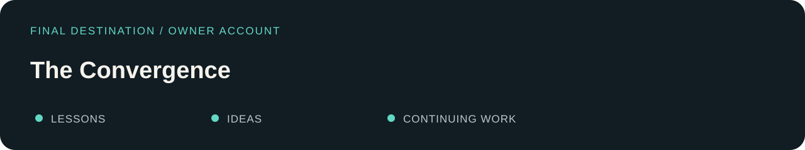

# The Convergence

**Owner account.** Mario says the lessons and ideas from these attempts culminated in his separate working project, [VALOR_ASCENDENT](https://github.com/Cyber-Mario1979/VALOR_ASCENDENT).

The historical reading route reaches [The Unfinished Trial](../cases/09-pe-app.md), with its accepted synthetic M0 checkpoint and closed-unmerged later branch preserved. The Convergence follows that case as Mario’s account of where the lessons went.

State, evidence, authority, scope and honest acceptance remain the themes that connect the journey. The ten legacy cases retain their documented outcomes and limits.

[← What remained useful](07-useful-remains.md) · [Return to the landing page →](../README.md)
